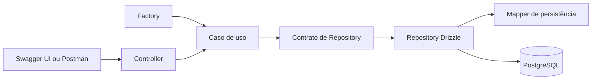

# Minha Rotina: desenho técnico do backend

Status: backend e operações de participantes, metas, registros e progresso implementados; CI validado no PR #17.

## Tecnologias

A API usará a porta local `3333`, com URL base `http://localhost:3333`. Essa porta é uma convenção do projeto.

| Responsabilidade | Tecnologia |
|---|---|
| Runtime e linguagem | Node.js e TypeScript |
| API HTTP | Fastify |
| Validação dos DTOs de entrada | Zod |
| Persistência | Drizzle ORM e PostgreSQL |

Versões resolvidas estão fixadas em `pnpm-lock.yaml`. Docker Compose usa PostgreSQL 17 na porta local 5439; a API aplica migrations versionadas ao iniciar. Swagger UI está disponível em `/docs/`.

## Camadas

Todos os identificadores de código são em inglês: funções e variáveis em `camelCase`, classes em `PascalCase`, tabelas e colunas em `snake_case`. Rotas e campos JSON também são em inglês. Os modelos são `Participant`, `HabitGoal` e `PracticeRecord`; termos de domínio e explicações na documentação permanecem em português.

A aplicação é organizada em `src/core`, `domain/habits` e `infra`. Casos de uso concentram regras e recebem contratos de repositório por construtor; factories conectam esses contratos às implementações concretas. Controllers são funções Fastify por operação, e os schemas HTTP definem os DTOs de entrada e saída.

O [modelo da estrutura de pastas](./project-structure.md) detalha todos os diretórios, arquivos de entrada e responsabilidades. As regras não são decididas pelos controllers ou por consultas SQL. Restrições e transações do banco garantem a integridade das escritas.

## Banco e migrations

Os IDs das três entidades são UUIDs gerados pelo backend, representados como strings na API e armazenados em colunas `uuid` no PostgreSQL. Chaves estrangeiras também usam `uuid`.

A implementação usa Drizzle Kit para gerar migrations SQL versionadas e aplicar as migrations pendentes antes de iniciar a API. Alterações posteriores geram novas migrations; não se edita uma migration já aplicada.

O fluxo `generate` e `migrate` mantém o histórico exigido na disciplina. Referência: [migrations no PostgreSQL com Drizzle](https://orm.drizzle.team/docs/migrations).

## Datas

O calendário de negócio usa `America/Sao_Paulo` para todos os participantes. Datas de início e de prática usam `AAAA-MM-DD` na API e colunas PostgreSQL `date`, sem conversão para timestamps de meia-noite. A validação do dia atual deve usar explicitamente esse fuso, independentemente do fuso do servidor.

## Equivalência com a disciplina

- Controllers Fastify correspondem à camada HTTP do Spring.
- Casos de uso correspondem à responsabilidade dos Services; a organização das pastas foi aceita pelo professor, conforme informado por Felipe.
- Schemas Zod validam os DTOs de entrada.
- Modelos TypeScript e schemas Drizzle representam as entidades e seu mapeamento para tabelas.
- Implementações de Repository encapsulam o Drizzle; contratos pertencem à camada de aplicação.
- Migrations SQL versionadas cumprem a responsabilidade do Flyway.
- O tratamento central de erros devolverá `message` e `metadata.fields`, com status somente no HTTP. Essa adaptação foi aprovada pelo professor, conforme informado por Felipe.

## Estado atual

As rotas e regras descritas neste desenho estão implementadas. O workflow de CI executado no PR #17 passou com PostgreSQL, migrations, testes unitários e de integração, build e verificação do OpenAPI. A conferência acadêmica final permanece registrada em [autoavaliação](../autoavaliacao.md).