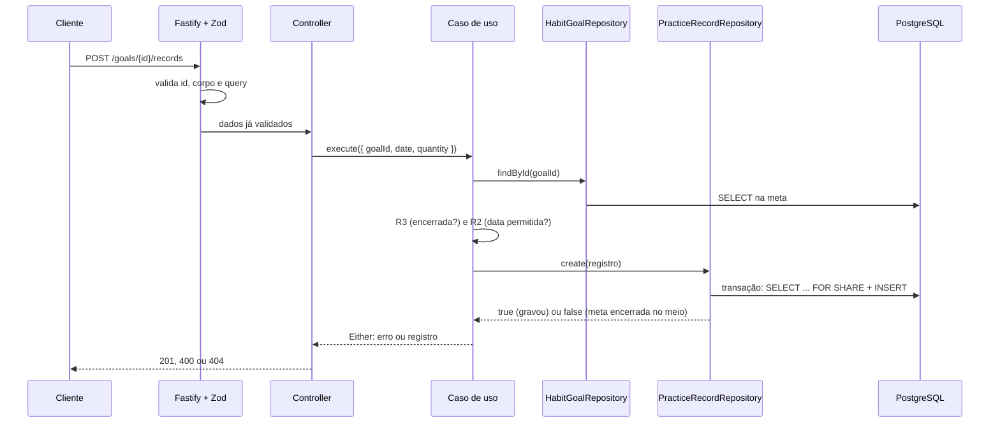

# Manual: registro de prática (`POST /goals/{id}/records`)

Responsável: Renan Floriano. Este manual explica o que acontece desde a chegada da requisição até a resposta, onde cada regra está e como os testes comprovam o comportamento.

## 1. O que a rotina faz

O participante informa que praticou uma atividade de uma meta: em qual dia (`date`) e quanto (`quantity`). O sistema confere se a meta existe, se ainda está aberta e se a data é permitida. Se tudo estiver certo, grava o registro com um UUID novo e devolve `201`.

A unidade não é enviada: o registro usa a unidade da meta. Uma meta de 30 minutos que recebe 15 e 20 minutos no mesmo dia guarda os dois registros; o total de 35 ultrapassa o alvo, e isso é permitido.

Requisição:

```http
POST /goals/189bc8fc-9e93-4c18-a48e-d11fd7ad4b02/records
Content-Type: application/json

{"date":"2026-10-09","quantity":15}
```

Resposta `201`:

```json
{"id":"90855dc9-f3bc-4f92-aab7-b8b20e8c4cd3","goalId":"189bc8fc-9e93-4c18-a48e-d11fd7ad4b02","date":"2026-10-09","quantity":15}
```

## 2. Caminho da requisição



Passo a passo:

1. **Validação de entrada (Zod).** Antes do controller rodar, o Fastify confere o schema da rota: `id` precisa ser UUID, o corpo só pode ter `date` e `quantity`, e a rota não aceita parâmetros de consulta. Se algo falhar, o tratamento central de erros devolve `400` com `metadata.fields`. O controller nem é chamado.
2. **Controller.** Junta o `id` da URL com o corpo e chama o caso de uso montado pela factory.
3. **Factory.** Cria o caso de uso com os dois Repositories do PostgreSQL. É a "injeção de dependência" feita à mão.
4. **Caso de uso.** Busca a meta e aplica as regras na ordem da seção 4. Se passar, cria a entidade `PracticeRecord`, que gera o UUID.
5. **Repository de registros.** Grava dentro de uma transação que trava a meta contra um encerramento simultâneo (seção 6).
6. **Resposta.** O controller converte o resultado: registro vira DTO com `201`; meta inexistente vira `404`; qualquer outra falha esperada vira `400`.

## 3. Arquivos e camadas

Caminhos relativos a `src/`.

| Camada da disciplina | Arquivo | O que faz |
|---|---|---|
| Model | `domain/habits/enterprise/entities/practice-record.ts` | Entidade do registro: `goalId`, `date`, `quantity`; herda `Entity`, que gera o UUID |
| Model | `domain/habits/enterprise/entities/habit-goal.ts` | Entidade da meta; aqui usamos `startDate` e `isClosed` |
| Service auxiliar | `domain/habits/enterprise/services/today-in-sao-paulo.ts` | Devolve a data de hoje em São Paulo no formato `AAAA-MM-DD` |
| Repository (contrato) | `domain/habits/application/repositories/habit-goal-repository.ts` | `findById(id)`: busca a meta |
| Repository (contrato) | `domain/habits/application/repositories/practice-record-repository.ts` | `create(registro)`: grava e devolve `false` se a meta foi encerrada no meio |
| Service | `domain/habits/application/use-cases/create-practice-record.ts` | Regras R2 e R3 |
| Erros | `domain/habits/application/use-cases/errors/habit-goal-not-found-error.ts` | "Meta não encontrada." |
| Erros | `domain/habits/application/use-cases/errors/habit-goal-closed-error.ts` | R3 |
| Erros | `domain/habits/application/use-cases/errors/invalid-practice-date-error.ts` | R2, com a mensagem de cada caso |
| Repository (PostgreSQL) | `infra/db/drizzle/repositories/habit-goal-repository.ts` | `SELECT` da meta |
| Repository (PostgreSQL) | `infra/db/drizzle/repositories/practice-record-repository.ts` | Transação com `FOR SHARE` e `INSERT` |
| Mapper | `infra/db/drizzle/mappers/drizzle-habit-goal-mapper.ts` | Linha do banco → `HabitGoal` |
| Mapper | `infra/db/drizzle/mappers/drizzle-practice-record-mapper.ts` | `PracticeRecord` ↔ linha do banco; IDs viram string |
| DTO | `infra/http/schemas/practice-record.schema.ts` | Schemas Zod de entrada e saída e `toPracticeRecordDto` |
| Controller | `infra/http/controllers/create-practice-record.controller.ts` | Rota, documentação Swagger e conversão para HTTP |
| Config | `infra/http/factories/make-create-practice-record-use-case.ts` | Monta o caso de uso com os Repositories concretos |

O caso de uso conhece apenas os **contratos** dos Repositories (classes abstratas). Por isso os testes unitários trocam o PostgreSQL por Repositories em memória (`test/repositories/`) sem mudar o caso de uso.

## 4. Regras e ordem das verificações

O caso de uso verifica nesta ordem e para no primeiro problema:

| # | Situação | Regra | HTTP | Mensagem |
|---|---|---|---|---|
| 1 | Meta não existe | - | `404` | Meta não encontrada. |
| 2 | Meta encerrada (qualquer data) | R3 | `400` | A meta está encerrada e não aceita novos registros. |
| 3 | Meta começa depois de hoje | R2 | `400` | A meta ainda não começou; registros são aceitos a partir de AAAA-MM-DD. |
| 4 | Data depois de hoje | R2 | `400` | A data da prática não pode ser posterior a hoje. |
| 5 | Data antes do início da meta | R2 | `400` | A data da prática não pode ser anterior ao início da meta. |
| 6 | Meta encerrada durante a gravação | R3 | `400` | A meta está encerrada e não aceita novos registros. |

O intervalo permitido é **início da meta ≤ data ≤ hoje**, com os dois limites incluídos. As datas são comparadas como texto (`'2026-10-09' < '2026-10-13'`), o que funciona porque o formato `AAAA-MM-DD` coloca ano, mês e dia em ordem.

O que é permitido de propósito: vários registros na mesma data e quantidades acima do alvo diário. O alvo é um objetivo, não um limite.

Os erros de regra têm `metadata.fields` vazio, como no exemplo do contrato:

```json
{"message":"A data da prática não pode ser anterior ao início da meta.","metadata":{"fields":[]}}
```

## 5. Por que "hoje" é de São Paulo

O servidor pode rodar em qualquer fuso (o CI do GitHub roda em UTC). Se usássemos a data do servidor, às 23:30 de 13/10 em São Paulo o servidor em UTC já estaria em 14/10 e aceitaria um registro "de amanhã". `todayInSaoPaulo()` usa `Intl.DateTimeFormat` com `timeZone: 'America/Sao_Paulo'`, então hoje é sempre a data do calendário de São Paulo.

## 6. Corrida entre registro e encerramento (R3)

O problema: o caso de uso lê a meta e vê que está aberta. Antes de gravar, outra requisição encerra a meta. Sem cuidado, o registro seria gravado numa meta já encerrada.

A solução fica em `DrizzlePracticeRecordRepository.create`, numa única transação:

```sql
BEGIN;
SELECT id FROM habit_goals WHERE id = $1 AND closed_at IS NULL FOR SHARE;
-- se não encontrou: não grava e devolve false
INSERT INTO practice_records (...) VALUES (...);
COMMIT;
```

`FOR SHARE` é um "cadeado de leitura" na linha da meta. Ele não pode coexistir com o `UPDATE habit_goals SET closed_at = ...` do encerramento. Há dois cenários:

| Quem chega primeiro | O que acontece |
|---|---|
| O encerramento | O `SELECT ... FOR SHARE` espera o encerramento terminar. Depois, a meta já tem `closed_at`, o `SELECT` não a encontra, nada é gravado e o caso de uso devolve `400` (R3) |
| O registro | O `UPDATE` do encerramento espera o registro terminar de gravar. O registro foi feito antes do encerramento, então é válido |

Em nenhum caso fica um registro gravado depois do encerramento efetivo. O encerramento (issue do João) não precisa de nada especial além de um `UPDATE` comum na linha da meta. Não houve mudança no banco nem nas migrations.

Isso segue o mesmo padrão do cadastro de participantes: lá, `create` devolve `false` quando o banco recusa um e-mail duplicado numa corrida, e o caso de uso transforma isso em erro.

## 7. Validação dos campos

Feita pelo Zod em `practice-record.schema.ts`, antes do caso de uso:

| Entrada | Resultado |
|---|---|
| `date` fora de `AAAA-MM-DD`, ou dia que não existe (`2026-02-29`, `2026-04-31`) | `400`, campo `date` |
| `quantity` zero, negativa, fracionária, texto (`"15"`) ou acima de 2.147.483.647 (limite da coluna `integer`) | `400`, campo `quantity` |
| Campo a mais, como `observacao` ou `unit` | `400`, "Campo não permitido." |
| `quantidad` no lugar de `quantity` | `400`, campo desconhecido e campo obrigatório ausente |
| `?pag=1` na URL | `400`, "Parâmetro não permitido." |
| `id` que não é UUID | `400`, campo `id` |

## 8. Testes

| Tipo | Arquivo | O que cobre |
|---|---|---|
| Unitário | `src/domain/habits/application/use-cases/create-practice-record.spec.ts` | Regras do caso de uso com Repositories em memória |
| Integração | `test/integrations/practice-records.integration.spec.ts` | HTTP real + PostgreSQL: contrato, validação, R2, R3, `404` e corrida |

**Controle do relógio.** Os testes fixam a data do sistema com `vi.useFakeTimers({ toFake: ['Date'] })` e `vi.setSystemTime(...)`. "Hoje" nos testes é sempre 13/10/2026, ao meio-dia de São Paulo, e um teste muda o horário para 23:30 para conferir a virada do dia. Só `Date` é falsificado, para não atrapalhar os temporizadores do PostgreSQL.

**Teste da corrida.** O teste abre uma transação separada que encerra a meta e ainda não confirma. Em seguida envia o `POST`, espera o PostgreSQL mostrar a requisição aguardando o cadeado, confirma o encerramento e verifica que a resposta é `400` e que nada foi gravado. Removendo o `FOR SHARE`, esse teste falha. Isso prova que o cadeado é o que garante a regra.

Até a rota `POST /goals` existir, os testes HTTP inserem metas diretamente no banco.

Comandos:

```bash
pnpm test:unit
pnpm test
```

## 9. Como demonstrar

Enquanto `POST /goals` não estiver pronto, crie uma meta pelo banco (troque o UUID do participante por um existente):

```sql
INSERT INTO habit_goals (id, participant_id, name, normalized_name, daily_target, unit, start_date)
VALUES ('189bc8fc-9e93-4c18-a48e-d11fd7ad4b02', '<uuid-do-participante>', 'Caminhar', 'caminhar', 30, 'MINUTES', '2026-10-09');
```

Pelo Swagger (`http://localhost:3333/docs/`) ou Postman:

1. Registrar 15 e depois 20 na mesma data → dois `201`; o total passa do alvo.
2. Registrar amanhã → `400` (R2).
3. Registrar antes do início → `400` (R2).
4. Enviar `"quantity": 0` → `400` com o campo `quantity`.
5. Usar um UUID de meta que não existe → `404`.
6. Encerrar a meta (`POST /goals/{id}/closure` quando existir, ou `UPDATE habit_goals SET closed_at = now() WHERE id = ...`) e registrar uma data passada válida → `400` (R3).

## 10. Perguntas que podem aparecer

**Onde ficam as regras de negócio?** No caso de uso `create-practice-record.ts`. O controller só traduz para HTTP, e o banco só garante integridade e a corrida.

**Por que a unidade não vem no corpo?** O registro herda a unidade da meta. Assim uma meta em minutos não recebe registros em ml. Enviar `unit` retorna `400`, como qualquer campo desconhecido.

**Por que comparar datas como texto?** No formato `AAAA-MM-DD`, a ordem alfabética é igual à ordem do calendário. Não é preciso converter para `Date` nem lidar com fuso.

**Por que o caso de uso verifica "encerrada" se o Repository também verifica?** A verificação do caso de uso responde ao caso comum de forma clara. A do Repository cobre o caso raro em que o encerramento acontece entre a leitura e a gravação.

**Por que `FOR SHARE` e não `FOR UPDATE`?** `FOR SHARE` basta para bloquear o `UPDATE` do encerramento e permite que vários registros da mesma meta sejam gravados ao mesmo tempo. `FOR KEY SHARE`, que é o bloqueio criado pela chave estrangeira, não bastaria, porque encerrar a meta não altera a chave.

**Como os testes não dependem do dia em que rodam?** A data do sistema é fixada nos testes com `vi.setSystemTime`.

**Por que `404` só para meta inexistente?** É a convenção do contrato: recurso que não existe é `404`. Violações de regra sobre um recurso existente são `400`.

## 11. Combinados com o João

- `HabitGoal`, `HabitGoalRepository.findById`, `DrizzleHabitGoalRepository`, `DrizzleHabitGoalMapper` e `HabitGoalNotFoundError` foram criados na versão mínima que o registro precisa. A issue de metas deve ampliar esses arquivos, não criar outros.
- O encerramento deve ser um `UPDATE` em `habit_goals.closed_at`, o que já basta para o cadeado funcionar.
