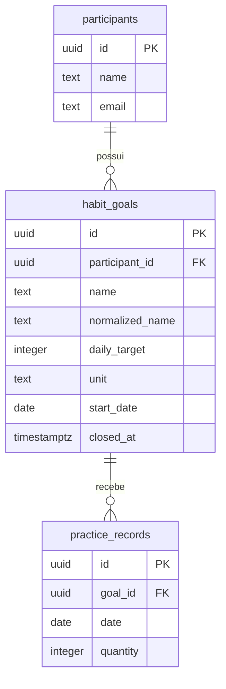

# Minha Rotina: modelo de domínio

Status: schemas e migrations das três tabelas implementados; modelo de participantes implementado; operações de metas e registros pendentes.

O [vocabulário](../CONTEXT.md) define os termos. O sistema acompanha metas diárias pessoais e preserva as quantidades praticadas ao longo do tempo.

## Entidades e campos propostos

| Entidade | Campos |
|---|---|
| Participante | `id`, `name`, `email` |
| Meta de hábito | `id`, `participantId`, `name`, `normalizedName`, `dailyTarget`, `unit`, `startDate`, `closedAt` |
| Registro de prática | `id`, `goalId`, `date`, `quantity` |

Decisão confirmada: IDs UUID gerados pelo backend e armazenados como `uuid` no PostgreSQL; quantidades e alvos inteiros positivos; datas de negócio em colunas `date`. `closedAt` é um timestamp opcional para registrar o instante do encerramento. Ausência desse instante significa meta não encerrada, mesmo que seu início seja futuro.

`normalizedName` é um campo técnico calculado pela aplicação, removendo espaços nas extremidades e convertendo o nome para minúsculas. Ele não entra no DTO público.

## Relacionamentos

- Participante 1:N Meta de hábito.
- Meta de hábito 1:N Registro de prática.
- Cada meta exige um participante existente e cada registro exige uma meta existente.
- O encerramento preserva a meta e seus registros. Exclusão não faz parte desta entrega.

## Restrições e cálculo

- Nomes de participantes e metas possuem de 1 a 100 caracteres após remover espaços nas extremidades. O valor normalizado apenas nesses espaços é armazenado e retornado, preservando a caixa; as colunas de nome usam `varchar(100)`, com restrição de conteúdo não vazio.
- E-mail do participante normalizado sem espaços nas extremidades e em minúsculas, com restrição única no banco. O caso de uso verifica a duplicidade e traduz eventual conflito de unicidade para HTTP 400, inclusive em cadastros simultâneos.
- Unidade: `ML`, `MINUTES` ou `REPETITIONS`.
- Alvo e quantidade maiores que zero.
- A meta e a unidade determinam o significado da quantidade; o registro não recebe outra unidade.
- Índice único parcial implementado em `(participant_id, normalized_name, unit)` onde `closed_at IS NULL`, para garantir a regra de duplicidade também em cadastros simultâneos. O caso de uso valida a regra e traduz eventual conflito do banco para HTTP 400.
- Novos registros exigem meta não encerrada e data entre o início e hoje no calendário de São Paulo.
- Progresso diário e dia cumprido são calculados, não tabelas: `total = sum(quantity)` e `completed = total >= dailyTarget`.
- Vários registros na mesma data são permitidos. Cada registro contribui apenas para a meta à qual pertence.

## Histórico

Alvo e unidade não são alterados após o cadastro. Uma nova configuração exige encerrar a meta anterior e criar outra. Consultas históricas continuam disponíveis após o encerramento, mas a meta não aceita registros atrasados.

## Implementação

As três tabelas estão definidas nos schemas Drizzle e são criadas por migrations SQL versionadas. Os modelos internos e DTOs serão separados; os Controllers não devolverão linhas do banco diretamente.
